# 🛡️ ShieldScan – Website Security Scanner

A non-intrusive web vulnerability scanner that checks a website's **HTTP security headers**, **SSL/TLS certificate**, **common misconfigurations** and **risky open ports**, then gives a **security score (0–100)**, an **A–F grade** and a clear **"How to fix"** for every issue.

🔗 **Live demo:** [shieldscan-eta.vercel.app](https://shieldscan-eta.vercel.app)

> Built as part of the **Sqrock IT Solutions** internship — Phase 2, Task 3.

> ⚠️ **For educational and authorized testing only.** Scan only websites you own or have explicit permission to test. ShieldScan identifies problems and recommends fixes. It never exploits vulnerabilities.

---

## 📸 Screenshots

### Homepage
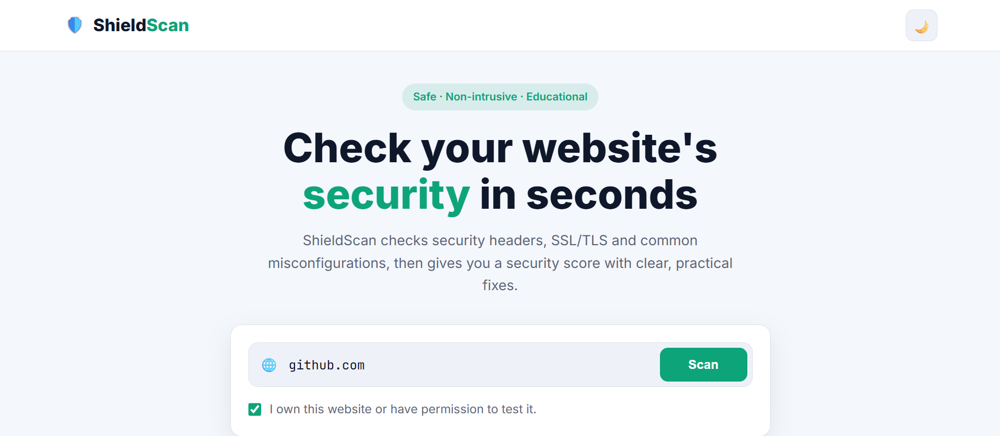
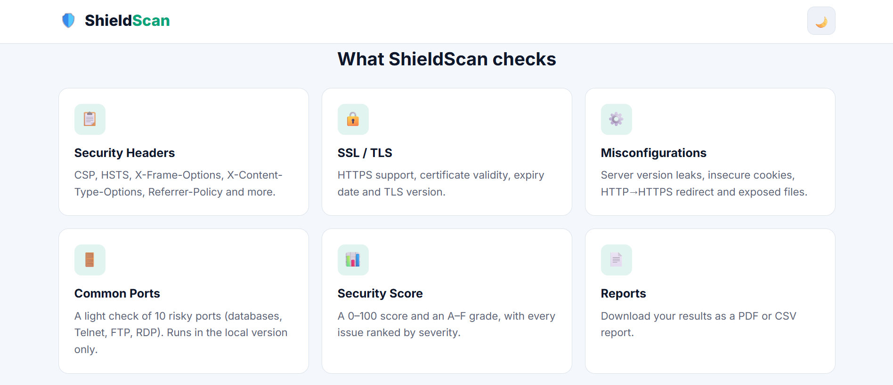

### Results dashboard
| Light mode (Grade A) | Dark mode (Grade F) |
|---|---|
| 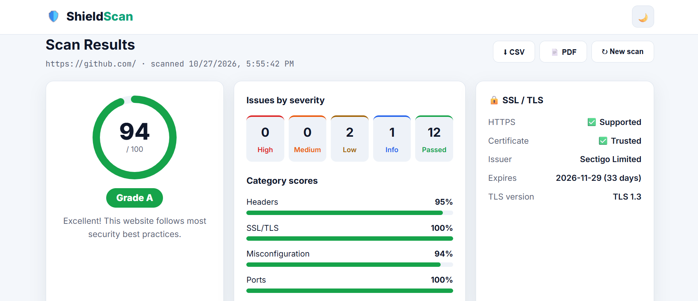 | 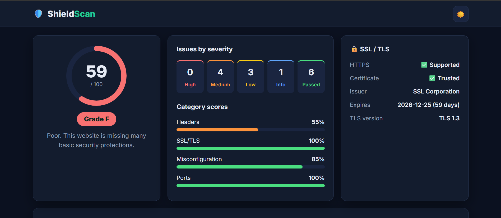 |

| Vulnerability statistics | Findings with fixes |
|---|---|
| 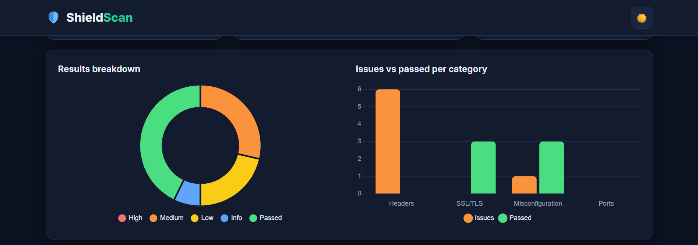 | 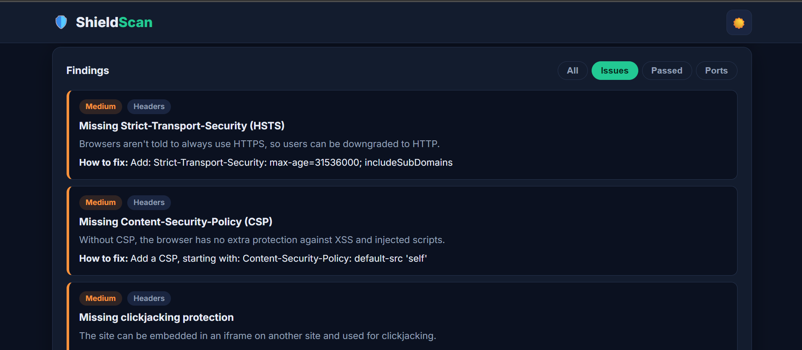 |

### Reports
| PDF report | CSV export |
|---|---|
| 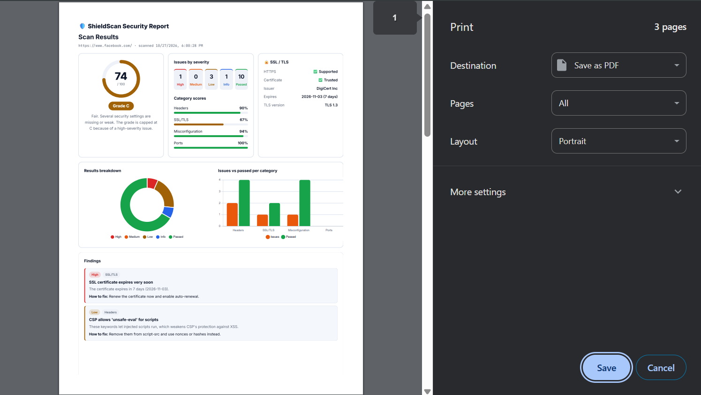 | 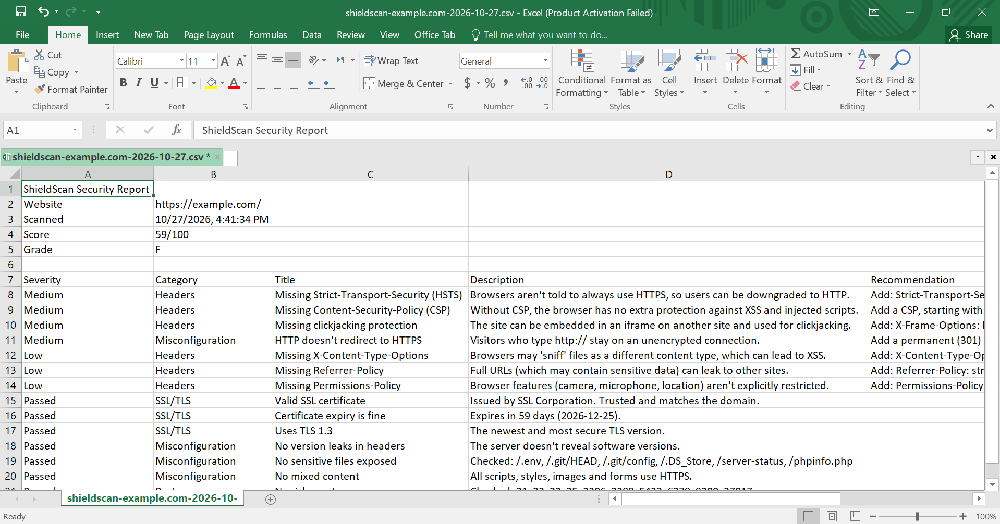 |

### SSRF protection
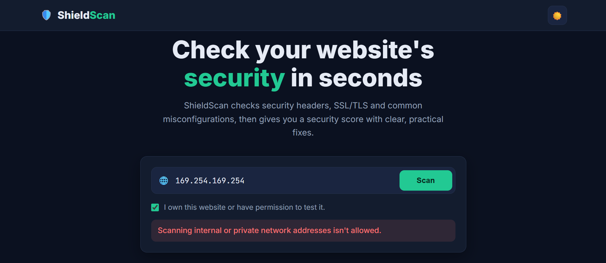

### Mobile
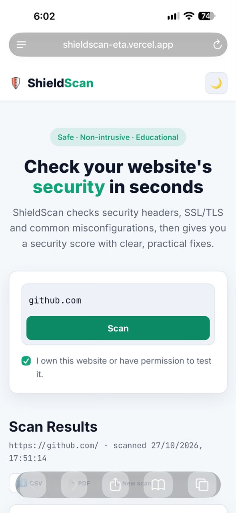 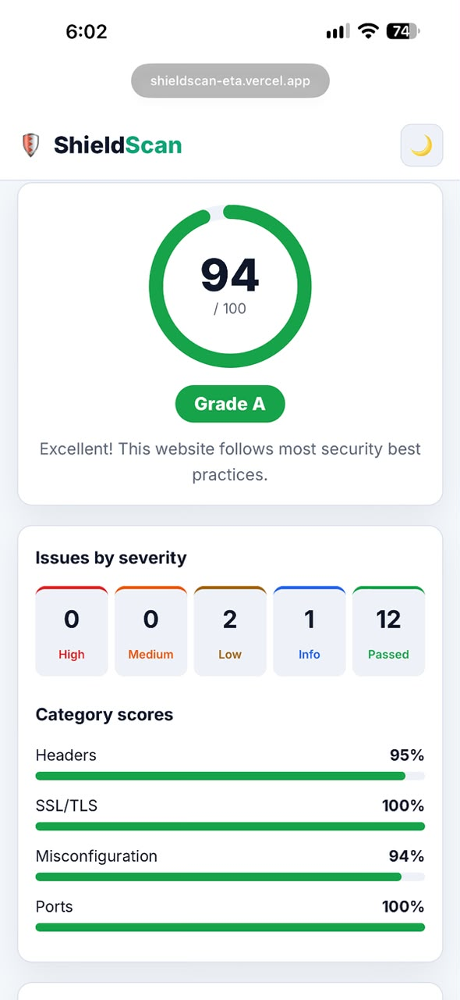

---

## ✨ Features

### Core features
- **Attractive, responsive UI** — works on desktop, tablet and mobile
- **Target URL input** — accepts `example.com`, `https://…`, paths and query strings, with strict validation
- **Vulnerability scanning** — about 25 checks across 4 categories in one scan
- **HTTP security header analysis** — HSTS, CSP, clickjacking protection, and more
- **SSL/TLS certificate inspection** — trust, issuer, expiry and TLS version
- **Common misconfiguration detection** — version leaks, cookie flags, exposed files, mixed content, and more
- **Open port detection** *(optional feature)* — 10 commonly exposed risky ports
- **Results dashboard with severity levels** — High / Medium / Low / Info / Passed
- **Security report** — every finding explains the risk and how to fix it

### Bonus features
- 📄 **Export reports as PDF or CSV**
- 📊 **Dashboard with vulnerability statistics** — score gauge, category scores, doughnut and bar charts
- 🌙 **Dark mode** — remembered between visits

---

## 🧠 Scanning Methodology

```
 Target URL
     │
     ▼
 1. Validate ───────► format, scheme, port + DNS lookup
     │                every resolved IP must be public (SSRF protection)
     ▼
 2. Fetch page ─────► timeouts, 500 KB limit, every redirect re-validated
     │
     ├─► 3. Security headers ──► headers.py
     ├─► 4. SSL / TLS ─────────► ssl_check.py   (connects to the validated IP)
     ├─► 5. Misconfigurations ─► misconfig.py
     └─► 6. Ports ─────────────► ports.py       (local version only)
     │
     ▼
 7. Report ─────────► score, grade, category scores, sorted findings
     │
     ▼
   Dashboard + PDF / CSV
```

All checks are **non-intrusive**: ShieldScan reads response headers, performs a normal TLS handshake, opens plain TCP connections (without reading banners) and sends 6 GET requests to well-known file paths. It never sends attack payloads, guesses passwords or tries to exploit anything.

---

## 🔍 Security Checks Performed

### 1. HTTP security headers
| Check | Severity if it fails |
|---|---|
| `Strict-Transport-Security` (HSTS) present, with `max-age` of at least 180 days | Medium / Low |
| `Content-Security-Policy` present and restricts scripts (no `'unsafe-inline'` without a nonce/hash, no `'unsafe-eval'`) | Medium / Low |
| Clickjacking protection: `X-Frame-Options` or CSP `frame-ancestors` | Medium |
| `X-Content-Type-Options: nosniff` | Low |
| `Referrer-Policy` present and not weak (`unsafe-url`, `no-referrer-when-downgrade`) | Low |
| `Permissions-Policy` present | Low |

The CSP is parsed into directives, so only settings that really weaken it are reported.

### 2. SSL / TLS certificate
| Check | Severity if it fails |
|---|---|
| HTTPS is supported | High |
| Certificate is trusted (not expired, not self-signed, matches the domain) | High |
| Days until expiry (under 15 days / under 30 days) | High / Medium |
| TLS version (1.2 and 1.3 pass, 1.0 and 1.1 are outdated) | High |

### 3. Common misconfigurations
| Check | Severity if it fails |
|---|---|
| Software versions revealed (`Server`, `X-Powered-By`, `X-Generator`, `<meta name="generator">`) | Low |
| Cookie flags: `Secure` / `HttpOnly` / `SameSite` | Medium / Low |
| `http://` redirects to `https://` | Medium |
| Exposed sensitive files: `.env`, `.git/HEAD`, `.git/config`, `.DS_Store`, `/server-status`, `/phpinfo.php` | High |
| Directory listing enabled | Medium |
| Mixed content (scripts/styles or images loaded over HTTP on an HTTPS page) | Medium / Low |
| Forms that submit to `http://` | Medium |
| Password field on an unencrypted (HTTP) page | High |

Exposed files are detected by their **content** (for example `.git/HEAD` must start with `ref: refs/`), not just by a `200 OK` status. This avoids false positives on sites that answer every path with 200.

### 4. Open ports *(local version only)*
| Ports | Service | Severity if open |
|---|---|---|
| 3306, 5432, 6379, 9200, 27017 | MySQL, PostgreSQL, Redis, Elasticsearch, MongoDB | High |
| 23 | Telnet | High |
| 21, 3389 | FTP, Remote Desktop | Medium |
| 22, 25 | SSH, SMTP | Info |

If 8 or more ports answer, the result is reported as unreliable, because a firewall or anti-scan system is probably accepting every connection.

---

## 📊 Security Score

| Severity | Points lost |
|---|---|
| 🔴 High | −15 |
| 🟠 Medium | −8 |
| 🟡 Low | −3 |
| 🔵 Info / ✅ Passed | 0 |

The score starts at **100**. Any **high-severity** issue caps the score at **74 (Grade C)**, so a site with a critical problem (like no HTTPS) can't get an A or B.

| Score | Grade |
|---|---|
| 90–100 | A |
| 80–89 | B |
| 70–79 | C |
| 60–69 | D |
| 0–59 | F |

Each category (Headers, SSL/TLS, Misconfiguration, Ports) also gets its own score, based on how many of its checks passed.

---

## 🔐 Security of the Scanner Itself

A scanner connects to addresses chosen by its users, so it has to be protected from being misused:

- **Authorization required** — the permission checkbox is enforced on the **server**, not only in the browser
- **SSRF protection** — only `http`/`https`, only ports 80/443/8080/8443, no `user:pass@` URLs, and **every resolved IP must be public**. This blocks `localhost`, private networks (`192.168.x.x`, `10.x.x.x`), cloud metadata (`169.254.169.254`), IPv4-mapped IPv6 (`::ffff:127.0.0.1`) and URL-parser tricks (backslashes, control characters)
- **Every redirect is re-validated**, so a site can't redirect the scanner to an internal address
- **SSL and port checks connect to the validated IP**, not the hostname again
- **Resource limits** — 8 s without data, 20 s total per page, 500 KB per page, max 5 redirects, 16 KB request size
- **XSS-safe dashboard** — text from the scanned site is inserted with `textContent`, never `innerHTML`
- **CSV formula-injection protection** — cells starting with `=`, `+`, `-` or `@` are escaped
- **Subresource Integrity (SRI)** on Chart.js — the browser refuses the file if the CDN copy is changed
- **Port check disabled online** (`ENABLE_PORT_CHECK=0`), to keep the public version non-intrusive

---

## 🛠️ Tech Stack

| Layer | Technology |
|---|---|
| Backend | Python, Flask |
| HTTP requests | Requests |
| HTML analysis | BeautifulSoup |
| SSL/TLS + ports | Python `ssl` (OpenSSL) and `socket`, with `certifi` trusted roots |
| Frontend | HTML, CSS, JavaScript (no frameworks) |
| Charts | Chart.js |
| Deployment | Vercel |

---

## 📁 Project Structure

```
shieldscan/
├── app.py                  # Flask app: routes + scan pipeline
├── scanner/
│   ├── validator.py        # URL validation + SSRF protection
│   ├── fetch.py            # safe page download (limits, re-validated redirects)
│   ├── headers.py          # HTTP security header analysis
│   ├── ssl_check.py        # SSL/TLS certificate inspection
│   ├── misconfig.py        # common misconfigurations
│   ├── ports.py            # light open-port check (local only)
│   └── report.py           # score, grade and category scores
├── templates/
│   └── index.html
├── static/
│   ├── css/style.css
│   └── js/main.js          # dashboard, charts, CSV + PDF export
├── screenshots/
├── requirements.txt
└── vercel.json
```

---

## 🚀 Run Locally

**1. Clone the repo**
```bash
git clone https://github.com/meroaymann/shieldscan.git
cd shieldscan
```

**2. Create a virtual environment and install requirements**
```bash
python -m venv venv
venv\Scripts\activate        # Windows
# source venv/bin/activate   # macOS / Linux
pip install -r requirements.txt
```

**3. Run the app**
```bash
python app.py
```
Open **http://127.0.0.1:5000**

The port check is **on** locally by default. To turn it off, set `ENABLE_PORT_CHECK=0`. To run in debug mode, set `FLASK_DEBUG=1`.

**Safe test targets**
- `scanme.nmap.org` — the official Nmap test server, which allows scanning
- `example.com` — a domain reserved for documentation and examples

---

## ☁️ Deployment (Vercel)

1. Push the project to GitHub
2. Import the repository on [Vercel](https://vercel.com) (Framework Preset: **Other**)
3. Add the environment variable `ENABLE_PORT_CHECK` = `0`
4. Deploy — `vercel.json` handles the Flask setup

---

## ⚠️ Known Limitations

- **Surface-level checks only** — ShieldScan checks configuration, not application logic. It doesn't test for SQL injection, XSS in forms, or broken authentication, because that would require sending attack payloads.
- **Homepage only** — it analyses the page at the given URL, not the whole site.
- **JavaScript-rendered content** isn't analysed (the HTML is read as the server sends it).
- **Redirects to another domain** — headers and HTML come from the final page, while the SSL and port checks use the domain that was typed.
- **DNS rebinding** — the SSL and port checks connect to the validated IP, but the page download resolves the hostname again. Fully closing this gap would need a custom HTTP adapter that pins the IP.
- **No rate limiting or ownership verification** — the permission checkbox relies on the user being honest. A production scanner would add rate limits and domain verification (for example a DNS TXT record).
- **Port check runs locally only**, by design.

---

## 👩‍💻 Author

**Amira Ayman**
- GitHub: [@meroaymann](https://github.com/meroaymann)
- LinkedIn: [Amira Ayman](https://www.linkedin.com/in/amira-ayman-72580231b)

Built during the **Sqrock IT Solutions** internship program.